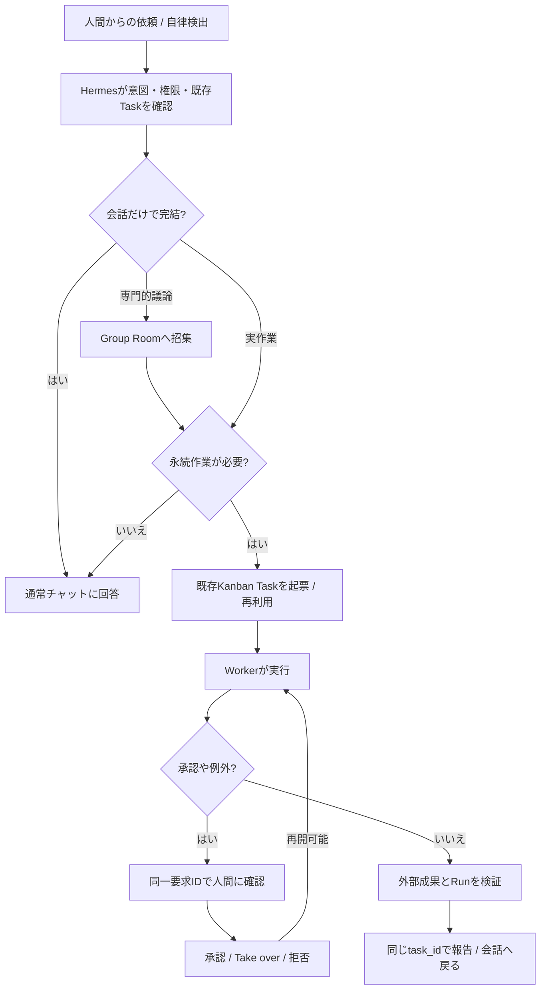

# Hermes Mobile 完成形UX — 会話・全員会話・仕事・自律実行をつなぐ操作設計

> **目的**：個々の画面を作る前に、Hermesの利用者が「何をしたいか」から完了までどう動くかを定義する。元の機能が利用できることと、自然に使えることは**両方必須**。
>
> **現段階は設計案**。画面配置の決定・実UIの実装・E2E受入・本番稼働を意味しない。原機能監査と受入ゲートは親の [[Hermes Mobile 完成形UX 非退行契約 20261015]] に従う。

## 1. 完成時に感じるべき体験

ユーザーは普段「Hermes」という一人のAIに話す。Hermesが問題を理解し、会話だけでよければ返答し、仕事なら専門Bot/Profile/Groupを呼び、永続実行が必要なら既存Kanban Taskへ引き渡す。誰に担当させるかを毎回人間が決める必要はないが、特定Bot・特定Group・全員との直接会話もいつでも開始できる。

特に重要なのは、**グループ会話を仕事の代用品にしないこと**。仕事には正本 task_id、会話には session_id、グループには既存room/snapshot、Profileには既存識別子があり、ひとつの仕事と多くの会話が関連できる。同じ仕事に戻ったとき、どこまで進んだか、次に誰が何をするか、失敗・承認・成果まで追える。

単なるチャットアプリではなく、次の４体験を一貫させる：
- **対話**：相談・依頼・複数Bot議論・各種ツールのやり取り。モデル等の高度な操作も残す。
- **仕事**：自律発見または人間指示から、長期間継続するKanban Task。ボードもタスク詳細も減らさない。
- **気づきと介入**：重要差分・承認・失敗・成果。文脈を保った即応、不要な確認の抑制。
- **能力管理**：Profile/Bot/Group/Skills/MCP/Cron/外部連携/端末の能力を、AIも人間も操作可能。

## 2. 画面の役割を「何をするか」で定義する

| 場所・サーフェス | 質問 | 主な操作 | 既存機能との関係 |
| --- | --- | --- | --- |
| **Conversation** | 今Hermes/このBotと何を話している？ | メッセージ、添付、音声、停止、検索、タイムライン、モデル/推論設定、招集、関連仕事の閲覧 | **既存ChatInputBar・ChatViewModelの能力を維持**。発話領域優先 |
| **Conversations一覧** | どの会話へ戻る？ | 履歴検索、Profile/Project/source絞込、ピン、名前変更、アーカイブ、非表示、分岐、削除、最近/未読 | 既存SessionsScreenの操作を丸ごと保持。高速会話ピッカーは別の簡易ビュー |
| **Group Room** | 誰の意見を聞く？ | Groupのメンバー、@all/@mention、発言停止、設定、Bot個別応答、議論のまとめ、仕事へ転送 | 既存GroupChatScreen/GroupChatViewModelを核に使う。Kanban Workerと混同しない |
| **Work** | 任せた仕事はどこまで進んだ？ | Kanban Board/Task、検索、状態変更、worker/runs、再割当、停止再開、検証、依存、添付、複数選択、import/export | 既存Kanbanの**フルボード/フル詳細を最優先に維持**。一覧表示は追加ビュー |
| **Attention/Inbox** | 自分が今判断すべきことは？ | 明確な承認要求、例外、ブロック解除、重要な提案、完了確認、既読、再通知設定 | 既存の要求ID・task_id・イベントを参照する投影。第二Kanbanにしない |
| **Agent/Capability管理** | 誰がどんな権限・機能を持つ？ | Profile/Soul/モデル、Bots/Groups、Skills、MCP、Cron、Webhook、Plugins、Projects、Files、Settings | 既存の全操作を保持。名前だけのリンクにはしない |
| **Live Work Surface** | AIが実際に何をしている？ | 実ブラウザ、Bot Screen、端末、ファイル、Diff、Tool logsを閲覧、Take over→Hand back | 権限/状態に応じて実画面を表示。マルチデバイス中断再開を追跡 |

**トップタブの数や上下位置はまだ決めない**。特にConversationは高密度なので下部タブを常設しない案を評価するが、グローバル移動・戻り先・文脈維持の実用性で決定する。

## 3. 会話画面：縦領域を守りながら旧操作を削らない

### 常時表示する要素の候補

1. **最小のヘッダー1行**：今の会話名/対象Profile・Room、接続状態（異常時）、新しい会話、検索/メニューの入口。タイトルタップで会話切替、対象タップでGroupメンバーやProfile詳細。
2. **伸縮するメッセージ領域**：本文/ツール実行/ストリーム/AI側からの進捗/Clarify、必要なら会話内のtaskカード。内容を消す固定のモード切替行は常設しない。
3. **既存の入力コンポーザー**：現在の ChatInputBar にあるモデル・推論/高速、添付/音声/画像/カメラ、コマンド、送信、実行停止等を再利用する。縮小する場合も展開状態に戻せる。IME表示時は本文領域とコンポーザーを優先。
4. **一時表示**：進行中のサブエージェント/進捗・警告・再送/破棄・承認・認証は、発生時だけチャット内で分かるようにする。「通知/Inboxへ移動しなければ操作できない」は不可。

スクリーンの背後でLive実行があっても、ユーザーの入力下書きはProfile/Session単位で保護し、セッション切替で消えない。通信断・再接続・同期競合が起きたら状態を明示し、**同じメッセージの再送を安易に強制しない**。

### 招集の操作（通常会話を壊さず全員と話す）

既存の1対1 Session中、ユーザーが「全員で検討して」と言う、またはコンテキストメニューの **「メンバーを招集」** を選ぶ。
- Hermesが「開発Team」「登録済み全Bot」「選んだBot」の候補を提示。既存Team/roomがあれば再利用を第一選択。
- 明示的に新しいGroup Roomを開き、**元会話と関連task_idを参照**する。元のsession_id・履歴は残し、その場で内容を黙って混在させない。
- デフォルトの「全員」は**指定したGroupの全メンバー**。全登録Botへ同時に依頼する場合は別途対象・費用/発言数を確認。@allや個別@mentionも利用可能。
- Group Roomから元の会話、各Botとの1対1、関連Kanban Taskへ文脈を保ったまま切り替えられる。
- Group Room内はリアルタイム発言と停止ができる。**Android ViewModelのループだけではアプリを閉じた後の継続実行を保証しない**。必要ならRoomの結論をKanban Swarmの親タスクへ明示ハンドオフ。
- 「結論を仕事に反映」は、作業対象と権限、既存Taskへのリンクか新規Taskかを確定して実行。重複Task起票しない。

### UI上の場所（参考ワイヤー、非実装）

```text
┌─ [≡]  Hermes / 会話名 ▾             [+] [⋯] ─┐
│                                                 │
│ メッセージ/実行内容/ツール結果/承認/状況         │
│                                                 │
│ [Hermes: 専門チームを招集しますか？]             │
│   [招集]  [元の会話を続ける]                      │
│                                                 │
│ ... 会話本文が最大領域 ...                       │
│                                                 │
├─────────────────────────────────────────────────┤
│ [＋ 添付]  [モデル/推論] [入力…] [録音/送信/停止] │
└─────────────────────────────────────────────────┘
```

※実表示は機種幅・フォント拡大・キーボードを考慮。これは操作の意味を示すもので、ボタン位置の最終仕様ではない。

## 4. 完成形の主要UXフロー（行動・例外・復帰まで）

### A. 普段の「Hermesに相談する」

1. 起点：ユーザーがHermesへ自然言語で質問。
2. Hermesが会話で解決可能か、専門Botへの相談が必要か、永続仕事かを判断。
3. 会話のみなら普通の返答。必要なら「研究Botの確認中」など**実際の進捗だけ**を短く表示。ユーザーは直接Botへ切替可能。
4. 長期化しそうな場合「仕事として引き受けます（目的/対象/委任範囲）」の要約を表示して既存Kanbanへ。事前委任内なら細かな再承認はしない。
5. ユーザーは会話を閉じてよい。後から「前の続き」で同じtask_idを検索/復帰。進行状況や停止理由は正本から読戻す。
6. 途中でモデル、推論、添付、音声等を操作しても、入力や元の会話を失わない。

### B. 全員会話・特定Bot・Group Chat

1. 「全員に聞く」または「専門Botを指名」する。通常時の担当決定はHermesが行う。
2. 既存Group/メンバーを確認。Groupがない場合にだけ作成を案内。登録済み全Botを無条件に大量起動しない。
3. 招集したRoomの発言は**Bot名と対応する実Session**が分かる。ユーザーは各Botに直接質問、@all、停止や上限設定を使用できる。
4. Bot同士が意見相違なら一方の回答を勝手に採用しない。差分と根拠、コスト、リスクをまとめる。本人に必要な判断だけを聞く。
5. 決まったら元の相談へ要約を戻す、既存タスクへコメント/アクションする、または継続Kanban Workerへハンドオフする。**実行権限は議論権限と別**。
6. Groupの画面から戻っても、会話履歴と対象Taskが追える。

### C. Kanbanで長い仕事を進める

1. 会話中「Hermes MobileのUXを改善して」と依頼→既存task_idがなければ重複確認の上起票。すでに存在するなら親タスクへ接続。
2. 必要に応じてCoder/Reviewer/Researcherを割当。親子関係、実Run/Worker、機器/計算資源の予約、外部証拠を既存Kanbanに格納。
3. ユーザーは**仕事のサマリー**と**フルKanbanボード/タスク詳細の五つの現行タブ（概要・議論・実行・活動・ファイル）**を切替可能。既存のステータス変更・再割当・見積・依存リンク・一括操作・import/exportは残す。
4. 「止めて」「Reviewして」「こっちのモデルへ」の指示は、対象の実Run/WorkerとTaskが分かるように操作。利用できる状態遷移だけ選択させる。
5. 実行の完了はKanbanのRun状態と成果物に基づく。PRのCIやファイル反映等は外部読戻しを検証に使う。
6. 失敗・blocked・再キューは原因、再試行回数、残り作業、人的判断を示す。「完了」と偽らない。
7. チャット・Work・通知タップのどこから入っても**同じTask**を表示し、戻ると元の場所へ復帰。

### D. Hermesが自分から仕事を始める

1. Cron/Webhook/Google連携/監視から新しい情報を受け取る。
2. 新規変化でなければ重複を抑止。すでに起票されたTaskなら追記する。
3. ユーザーが広く委任した範囲はHermesが実施。未知の操作、外部公開、支払、購読解除、破壊操作等は適用ポリシーに従って別途承認。ルールがあれば繰り返し聞かない。
4. 毎回発火を通常の会話一覧に大量表示しない。自動Sessionは起点でフィルタ可能な履歴として保持。重要な判断・報告だけAttentionへ。
5. 仕事の進行/中止/費用/結果はKanbanと実行ログ、外部システムから確認できる。**日次報告は差分中心、無駄な進捗通知を増やさない。**

### E. 承認とブラウザ操作の引き継ぎ

1. 作業中にログイン・MFA・判断が必要になったら、要求IDと対象task_id/roomを保持してblocked/waitingを明示。
2. 通知→要求内容→対象画面へ移動。発生元チャットでもInboxでも**同一要求**へ応答する。二重承認しない。
3. 認証が必要なら保護されたWeb/端末画面を開いてTake over。人間が入力し、資格情報が直接会話・ログに表示されない。
4. Hand back後、元のWorker/Taskを復帰。復帰ができなければ理由と再試行導線を示す。
5. 「今回は許可」「今後はこの条件で許可」「拒否」「委任を取り消す」を区別。継続委任はスコープ/送信先/操作種別を明確にする。

### F. 複数セッションと端末をまたぐ

1. 「会話名▾」から最近の会話をすぐ選択。詳細検索やアーカイブ/ピン/分岐/一括操作は既存のフル履歴操作へ。
2. 単なるSession切替では実Taskを失わない。各Taskに複数SessionやGroupを関連付け可能とする。
3. 自動実行Sessionと人間の会話は起点を区別。既存のHistorySection.CONVERSATIONS/AUTOMATIONSの区分を保持し、必要に応じて他のsourceへ拡張。
4. Android→Mac→ChatGPTで、同一IDと最新正本を読戻す。未同期の下書き・送信待ちの帰属を明示し、重複送信しない。
5. 異なる接続/プロフィールを切替えたとき、履歴・通知・要求・資格情報を跨いで見せない。

## 5. 同じ依頼がたどる状態図（概念／API設計前）



この図は業務意図の関係を示す。実装ではHermesのバックエンドが許容する本当の状態（triage/todo/scheduled/ready/running/blocked/review/done/archivedなど）と遷移制限を使用する。**UX都合で存在しない「実行中」ステータスを作らない**。状況表示はrun_id、heartbeat、ログに照らして行う。

## 6. 端末サイズごとの振る舞い（タブ位置は未決）

| 状況 | Chat | Work/Kanban | 共通 |
| --- | --- | --- | --- |
| 通常表示 | 本文を最も広く、ヘッダー1段＋既存composer | 状況要約からフルボードへ。小画面は横スクロール、フル詳細を残す | 戻り先と現在のTask/Session IDを維持 |
| キーボード展開 | 重複ナビゲーションは隠す。composer+本文優先 | 編集フォーム、入力の二重表示を避ける | IMEで判断ボタンが隠れない |
| ストリーム中 | 停止・ツール・送信状態が見える | Runは正本に依存し別端末から操作可能 | UI終了でWorkerを勝手にキャンセルしない |
| 承認待ち | 会話内のinline request | Task詳細やInboxでも同じrequestを表示 | 同時応答の整合性を保証 |
| 接続切断 | 元の会話・下書きを保持、失敗・再送状態を正確に表示 | 正本を読めなければ取得不能と表示 | 前の情報を最新と偽らない |
| 全員会話 | 発言者表示・@all・停止・発言上限。別Roomで保持 | 議論からTaskへ引き継ぐ | 討論の権限と実行の権限を分離 |
| 高度な設定操作 | モデル/推論・実行ツールへ会話を保って戻る | Workflows/Run/Files/Worker詳細 | 画面リンクのみで操作完遂としない |

## 7. 既存機能への移行契約（体験の単位）

| 元からできること | 新しい体験へ持ち込む方法 | 非退行の検証 |
| --- | --- | --- |
| ChatInputBarの添付/録音/コマンド/モデル/思考/停止 | **同じ実コンポーネントを再利用**。新専用コンポーザーで劣化させない | 同じSessionで送信・停止・失敗復旧・添付保存 |
| Session picker/Historyの検索/絞込/各種管理 | すぐ切替できる軽量Picker＋フルHistoryの**両方** | ソース/Project/ピン/アーカイブ/分岐と選択操作 |
| Profileの設定/Hub/Soul、Bots/Groupsの管理 | 共通のAgentsカタログで入口を整理、実管理操作はそのまま | 全Profile属性とGroup作成・解散・同期 |
| GroupChatの@mention/room lease/停止・会話限界 | 会話から招集できる入口＋既存GroupChat実体 | 発言停止・履歴復元・競合/失敗の扱い |
| Kanban full board・Run/Activity/Files等 | **Workの詳細としてフル実装を残す**。簡易カードは代替でなく要約 | 状態遷移、Worker制御、一括、入出力、run検証 |
| 自律Cron/Webhooks/Channels | Backend既存のCron/イベントを利用。重要情報だけInboxで集約 | ジョブの起動、変更監視、配送、失敗 |
| スキル/MCP/Plugins/Models/Settings/System | 必要な文脈から直接編集、全画面の高度機能も利用可能 | インストール/設定/接続テスト/更新/復旧 |
| Chat/Kanban通知 | 同一session_id / task_idへDeep-linkし、元画面へ戻れる | 再起動・バックグラウンド・通知タップ |
| 認証/資格情報・コネクター | セキュアなVault・OAuth/Browser引継ぎ、実権限に紐づくUI | Credential非露出・権限拒否・再開 |

## 8. 完成形を評価する具体的な10のデモ脚本

以下は単に押せる画面を並べるのではなく、**実データ・本当のID・本物の結果**で受け入れる。

1. 普通にHermesへ聞く → 回答 → モデル変更/添付 → 同じ文脈で継続。
2. 途中で「全員にも聞いて」 → Group Roomで3Bot以上の議論 → 個別Bot指名 → 元会話へ戻る。
3. Groupの合意を既存Kanban Taskに追加 → 子Task/Worker作成 → Androidを閉じても作業継続 → 戻って結果を確認。
4. Kanbanボードでタスク移動・一括操作・担当変更 → タスク詳細のRun/Activity/Filesへ移る → 元のWorkへ戻る。
5. CronがGitHubの変化を発見 → 既存Taskに重複なく追記 → Reviewerが検証 → 通知から同じTaskへ到達。
6. 広告メールの分類規則を本人が一度承認 → 次回から委任範囲で自動処理 → ルール取り消し → 以後適用しない。
7. Webログインが必要 → ブラウザTake over/MFA → Hand back → 同じWorkerで再開。
8. チャットで通信断 → 入力/添付は保持 → 復帰時に送信中・送信済を区別して二重送信しない。
9. 会話履歴で起点/Project絞込・検索・アーカイブ → 別Botで別Session → 元の会話へ復帰。
10. Mac/Android間の同一Task/Group/Session参照 → 反映読戻し → 通知・復帰先・実権限の確認。

**機能ソースの存在と実E2Eの合格を混同しない。** 各脚本に旧版/新UIの実操作動画、状態/ID、試験成否、未提供機能と代替策を記録する。既存機能が一つでも失われた場合、移行候補として採用しない。

## 9. 決めないこと・残る検証

- 下部3タブ、上部モードバー、「チャットを起動トップにする」等の詳細ナビゲーションは**未決**。シナリオの実測で選ぶ。
- Inboxの既読と承認要求をどの既存イベントから投影するか、必要なAPIやイベントID・スコープを確認する。
- Group Roomの永続性、アプリ終了時の挙動、会議→Kanbanの統合は実API契約と実測が必要。
- 既存Bots/Profileの見せ方、Groupメンバーの自動選択、全登録Bot会議の費用上限は現行基盤の仕様とコストを照合。
- チャット起点のモデル変更や承認は既存の接続プロフィール/Sessionスコープに従う。別接続の権限を自動昇格させない。
- Bot Screen/Browser/MacCTLのTake overは既存の専用権限・資格情報境界で成立する場合のみ利用。できる前提でデモを実装済みと呼ばない。
- 旧版機能の振舞いにAndroid固有の欠損やbackendの既知バグがあっても、隠したり削除したりせず課題として記録する。

## 10. 実装に進んでよい条件

親の「Hermes Mobile 完成形UX 非退行契約 20261015」のG0〜G5に加え、**各シナリオの元操作/新操作を対照表で確認できること**。画面はその後に設計する。旧ChatInputBar/GroupChat/Kanban Taskの再利用が実装計画に含まれない案は却下する。

本ドキュメントは**完成形を具体化する第一稿**。既存UXをすべて実証済みだとは主張しない。運用データや秘密情報は含まない。Flip7・Proxmox・本番Hermesを変更しない。旧UIを置き換えるPRは作らない。
