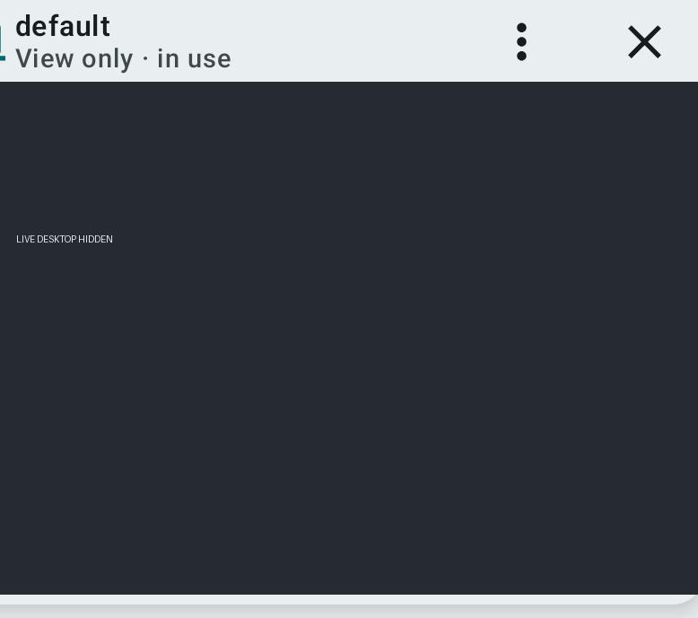

# Hermes Mobile Bot Screen

Open **Bots** and tap the eye icon to open the selected bot's **real chat**, with an inline Bot Screen video preview above the existing transcript and composer. The same ChatViewModel continues to handle messages, approvals and session history; the screen uses the selected bot profile. The **Bot Screen is now an app-wide floating window** (in the same Activity, not an Android system overlay), mounted once next to the navigation host rather than inside a particular chat. It stays visible while moving among Chat, Kanban, Bots, Settings and other authenticated screens. Drag its short title bar to move; drag the narrow lower-right grip to resize in both dimensions. Geometry is clamped inside the usable app viewport and remembers position and size for the active bot across in-app navigation and rotation. Tapping the floating window's compact overflow menu exposes Reconnect and Take over / Hand back; its close button ends the viewer. The existing Chat app bar still offers the computer menu for Show/Hide, Reconnect and a larger/smaller preset. Only the title bar and a small footer grip occupy additional space: the remote framebuffer has no overlaid toolbar. The floating view is unmounted when the dashboard is unauthenticated and is never rendered over the login page. Running screens connect automatically; otherwise choose Start screen from the app bar menu.

The viewer starts read-only. **Take over** acquires a Hermes `display.lease` for touch/keyboard input, **Hand back** returns control to the agent, and another viewer's takeover revokes local control. Leaving the screen attempts to return the lease. Network loss may leave a server lease behind.

The app uses profile-scoped `display.status`, `display.start`, `display.observe`, `display.lease.acquire`, and `display.lease.release` over the existing JSON-RPC connection. The `api/display/ws` RFB bridge uses a single-use, 30-second `display_ticket`, not a reusable login token. WebView intercepts a virtual document path **under the configured dashboard origin** while serving only packaged assets; all other HTTP resources are denied. This same-Origin strategy is required because Hermes rejects cross-origin display WebSockets, and it preserves the existing origin policy and reverse-proxy prefix. Release builds require encryption. noVNC 1.7.0 and vendor licenses are bundled under `app/src/main/assets/bot_screen/novnc/`.

Verification on 2026-10-15: Gradle compile, five protocol tests, `ktlintCheck`, `checkColorLiterals`, and `assembleDebug` passed. The Android 16 emulator installed the APK and displayed **Bot Screen · default**. The first build's local-appassets WebSocket failed (1006); the corrected same-Origin asset interception then connected without the disconnect message. The emulator subsequently showed **You control this Bot Screen** and **Hand back**; activating **Hand back** returned the UI to **Watching Bot Screen · read-only**, and AgentHub `hermes computer-use screen status` confirmed `control: agent`. This exercised the viewer lease and handback, but actual desktop pointer/keyboard movement has not been independently inspected. A subsequent Android WebView rendering bug was found: even after RFB connected and received a 1440×900 framebuffer, the HTML viewer's client height remained 0px (WebView innerHeight was 598px). The HTML now sets an explicit pixel height on connection and viewport resizes. On a fresh APK reinstall and re-open, the WebView viewer measured 387×598 and its previously uniform black screenshot region showed non-uniform rendered pixels (RGB channel standard deviations about 71–72, ranges 0–255); the final build again verified this non-blank region after removing diagnostic logs. The existing human control lease was relinquished during this acceptance; no Galaxy Flip7 production package was installed.

## Remote desktop audio

The existing RFB/noVNC bridge carries video and control **but not sound**. On the 2026-10-15 AgentHub host, FFmpeg is present (ALSA/Pulse capable) but no PulseAudio/PipeWire daemon, pactl or parec command was found. Therefore Bot Screen audio is **not currently transmitted** to Hermes Mobile. Adding audio would require a virtual sink/monitor (or another captured audio source) in the bot's virtual desktop session, an authenticated low-latency audio stream (e.g. Opus via WebRTC or WebSocket), and an opt-in playback/mute UI; this is an investigation, **not an implemented feature**. No audio service was installed or configured on AgentHub as part of the UI work.

## Floating-window QA (2026-10-15)

- Mac Android 16 emulator: installed a debug APK with `adb install -r` preserving app data. From Bots, opened the existing default Bot Screen, then navigated to Kanban. The same floating window stayed in the view (profile and control status in UI hierarchy) while the Kanban Board remained usable.
- Dragged the floating window's header from approx. x=520,y=296 to x=150,y=530 physical screen pixels: the profile label moved from approx. `[467,280][573,317]` to `[184,478][290,515]`.
- Dragged its bottom-right resize grip: the close button's right edge advanced from x=735 to x=917 pixels, demonstrating free resize.
- UI remains entirely inside app boundaries (no `SYSTEM_ALERT_WINDOW` overlay permission); Flip7 is unchanged.

## Floating viewer inside Hermes Mobile (2026-10-15)

The Bot Screen is now a **single floating player hosted above MainNavigation**, not a child of the current Chat route. It stays mounted when moving between **Chat, Bots, Kanban, settings, and other in-app screens**, retaining the same WebView and RFB viewer identity while the app is active.

- **Drag the player's upper title bar** to move it. Remote desktop touches remain routed to noVNC, not the player move gesture.
- **Drag the narrow bottom-right resize grip** to increase/decrease width and height independently. Size and position are clamped to the viewport, including narrow screens and rotation.
- **Close** via the floating title bar X; use the title-bar menu for reconnect, Take over/Hand back. Chat's computer icon can reopen/switch the player and use its size preset; the floating player itself is always accessible from any app screen.
- The initial floating size is 264×200 dp with a minimal 20 dp bottom resize strip. It does **not** create an Android system overlay or background PiP window outside Hermes Mobile.
- On closing, the viewer attempts to release a human input lease. Screen owner and actual server lease remain authoritative.

**Emulator verification:** Android 16 debug APK installed with app data preserved; Bot Screen opened from Bots; moving to Kanban and back to Chat retained the title controls and live viewer. A drag of the title moved its bounds from ~[467,280] to [184,478] in screen coordinates; a resize gesture increased right-side header bounds from x735 to x917, with the viewer area continuing to display nonuniform pixels. Three focused test classes (9 test cases total), `ktlintCheck`, `checkColorLiterals`, and `:app:assembleDebug` passed on Mac. Galaxy Flip7 unchanged by request.
