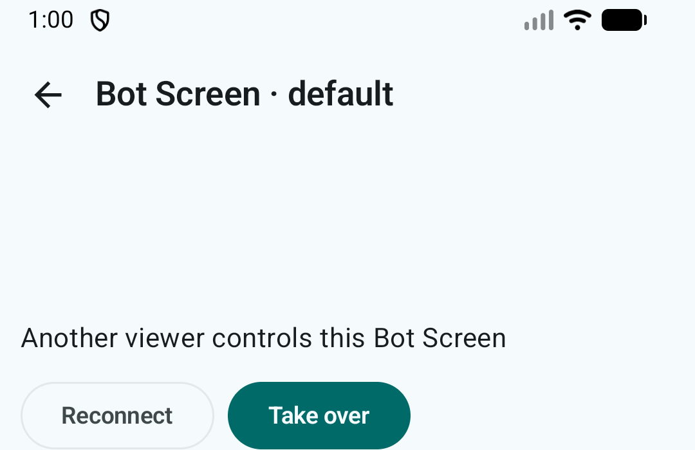

# Hermes Mobile Bot Screen

Open **Bots** and tap the eye icon to open the selected bot's **real chat**, with an inline Bot Screen video preview above the existing transcript and composer. The same ChatViewModel continues to handle messages, approvals and session history; the screen uses the selected bot profile. The regular Chat app bar is the **only header**. Tap its computer icon to access **Show/Hide Screen**, **Reconnect**, **Take over / Hand back**, and **Expand / Shrink preview**. There are no controls or status pills over the RFB image, and no second Bot Screen header. Default preview height is 196dp; enlarged 300dp; when the keyboard is open it is 112dp. Running screens connect automatically; otherwise choose Start screen from the app bar menu.

The viewer starts read-only. **Take over** acquires a Hermes `display.lease` for touch/keyboard input, **Hand back** returns control to the agent, and another viewer's takeover revokes local control. Leaving the screen attempts to return the lease. Network loss may leave a server lease behind.

The app uses profile-scoped `display.status`, `display.start`, `display.observe`, `display.lease.acquire`, and `display.lease.release` over the existing JSON-RPC connection. The `api/display/ws` RFB bridge uses a single-use, 30-second `display_ticket`, not a reusable login token. WebView intercepts a virtual document path **under the configured dashboard origin** while serving only packaged assets; all other HTTP resources are denied. This same-Origin strategy is required because Hermes rejects cross-origin display WebSockets, and it preserves the existing origin policy and reverse-proxy prefix. Release builds require encryption. noVNC 1.7.0 and vendor licenses are bundled under `app/src/main/assets/bot_screen/novnc/`.

Verification on 2026-10-15: Gradle compile, five protocol tests, `ktlintCheck`, `checkColorLiterals`, and `assembleDebug` passed. The Android 16 emulator installed the APK and displayed **Bot Screen · default**. The first build's local-appassets WebSocket failed (1006); the corrected same-Origin asset interception then connected without the disconnect message. The emulator subsequently showed **You control this Bot Screen** and **Hand back**; activating **Hand back** returned the UI to **Watching Bot Screen · read-only**, and AgentHub `hermes computer-use screen status` confirmed `control: agent`. This exercised the viewer lease and handback, but actual desktop pointer/keyboard movement has not been independently inspected. A subsequent Android WebView rendering bug was found: even after RFB connected and received a 1440×900 framebuffer, the HTML viewer's client height remained 0px (WebView innerHeight was 598px). The HTML now sets an explicit pixel height on connection and viewport resizes. On a fresh APK reinstall and re-open, the WebView viewer measured 387×598 and its previously uniform black screenshot region showed non-uniform rendered pixels (RGB channel standard deviations about 71–72, ranges 0–255); the final build again verified this non-blank region after removing diagnostic logs. The existing human control lease was relinquished during this acceptance; no Galaxy Flip7 production package was installed.

## Remote desktop audio

The existing RFB/noVNC bridge carries video and control **but not sound**. On the 2026-10-15 AgentHub host, FFmpeg is present (ALSA/Pulse capable) but no PulseAudio/PipeWire daemon, pactl or parec command was found. Therefore Bot Screen audio is **not currently transmitted** to Hermes Mobile. Adding audio would require a virtual sink/monitor (or another captured audio source) in the bot's virtual desktop session, an authenticated low-latency audio stream (e.g. Opus via WebRTC or WebSocket), and an opt-in playback/mute UI; this is an investigation, **not an implemented feature**. No audio service was installed or configured on AgentHub as part of the UI work.
