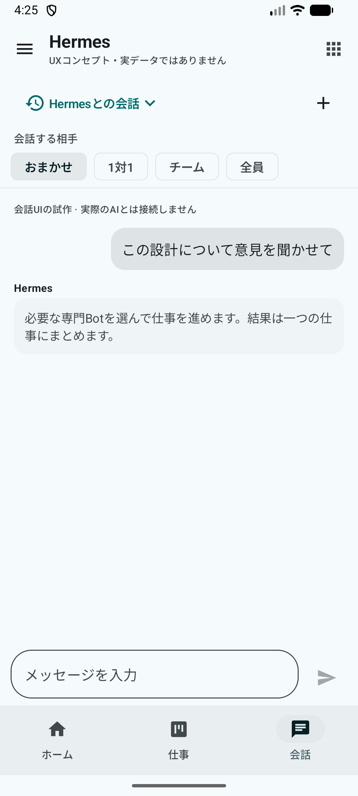
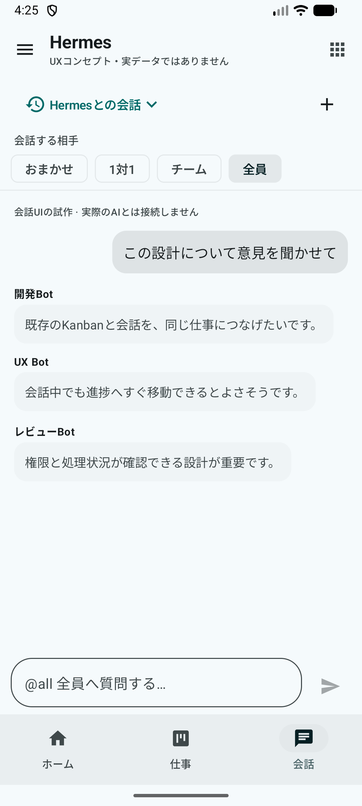
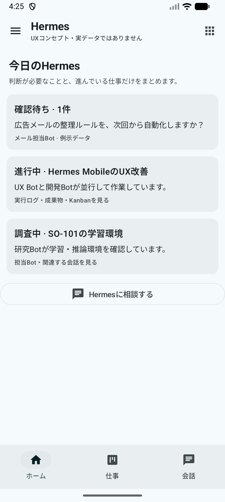
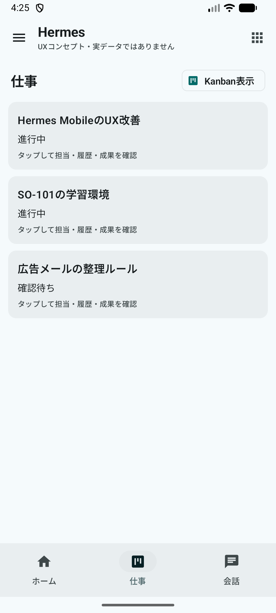
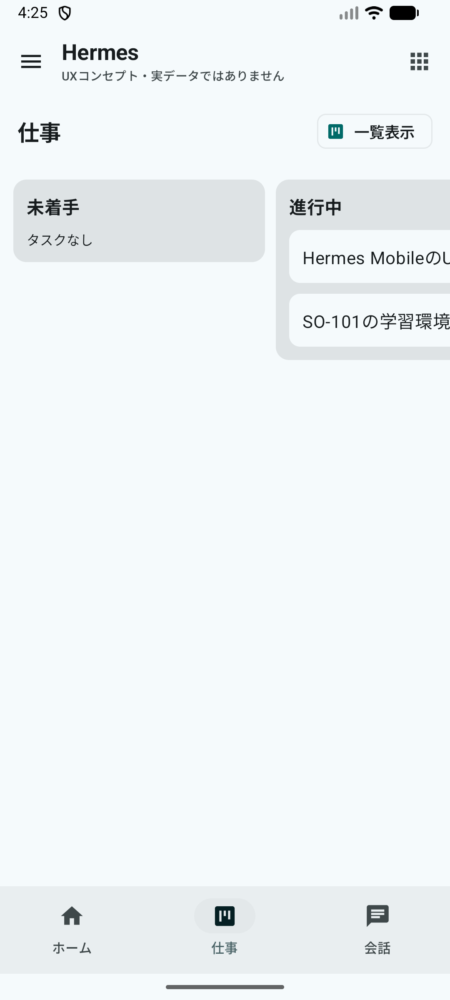

# Hermes Mobile — bottom navigation UX preview (2026-10-15)

This is an isolated **Japanese UX concept**, built from the Japanese localization feature branch. It does not submit prompts, approvals, tasks, or backend mutations.

- Runs **only in the `com.m57.hermescontrol.dev` debug APK** (temporary preview build). Normal release builds retain existing navigation.
- The primary navigation is at the **bottom**: Home / Work / Conversations.
- **Conversation target** is at the top of Chat: Automatic / One-on-one / Team / All. The message composer is at the bottom, and the navigation bar hides with the keyboard.
- Work has both a list and a Kanban presentation. The full-features menu is accessible from the top bar.
- Home/Work data and conversation messages are **illustrative fiction**, not real Hermes task/session/progress data.
- Bot routing, Group Chat, real Kanban task linkage, Inbox actions, session persistence, and full-features deep links require later integration. The demo **does not** pretend to execute any of them.
- Existing app screens, session APIs, and permissions are not modified. The unsynced session-picker branch remains untouched. No Flip7 install, production Hermes operation, or Proxmox access.

## Emulator screenshots

| Conversation | All-agents | Home | Work | Kanban |
| --- | --- | --- | --- | --- |
|  |  |  |  |  |

## Verification

- Gradle `:app:assembleDebug :app:ktlintCheck`: PASS.
- Mac Android emulator `emulator-5554`, Japanese locale `ja-JP`: PASS.
- UI automation text checks: Home / Work / Chat tabs visible, auto/solo/team/all mode choices visible, tap All shows three named Bots, Work shows a list, Kanban toggle operates, Home shows mock Inbox cards.
