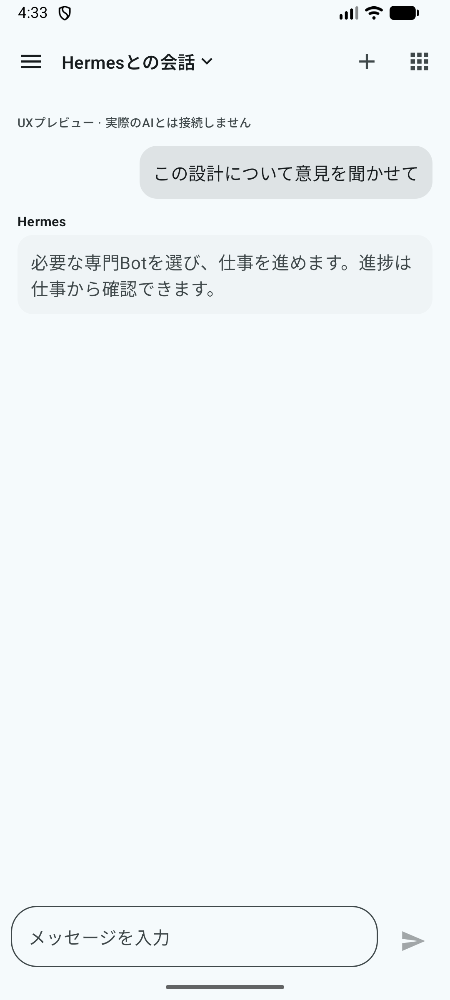
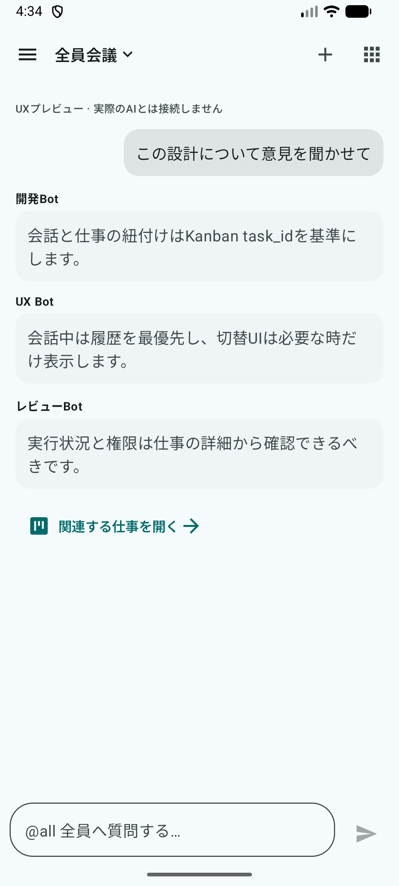
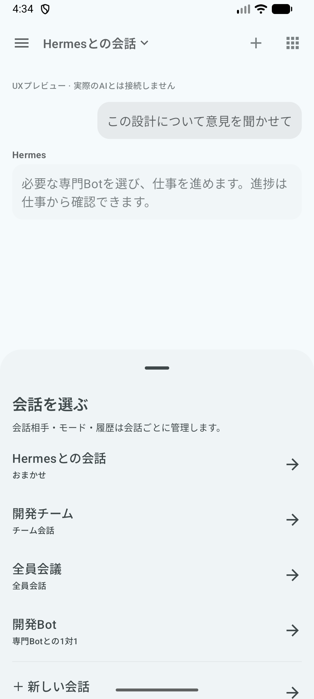
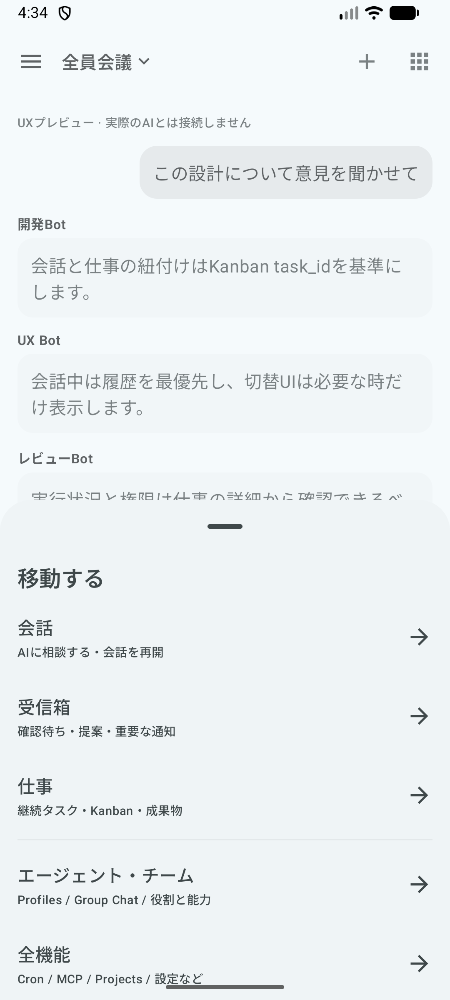
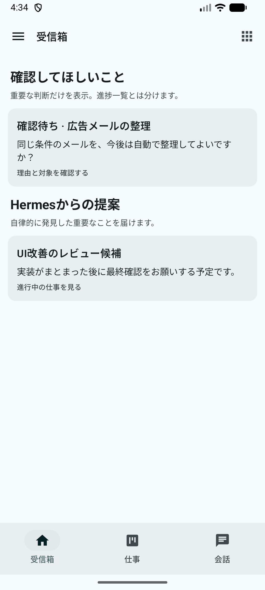
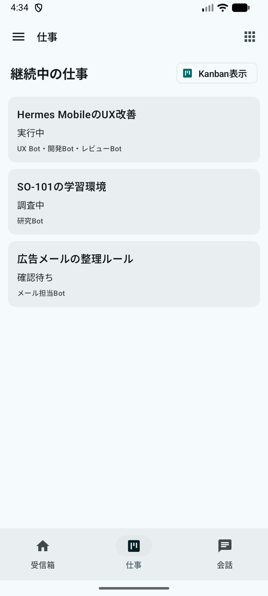
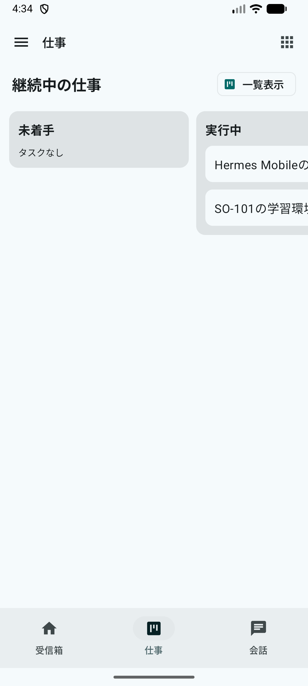
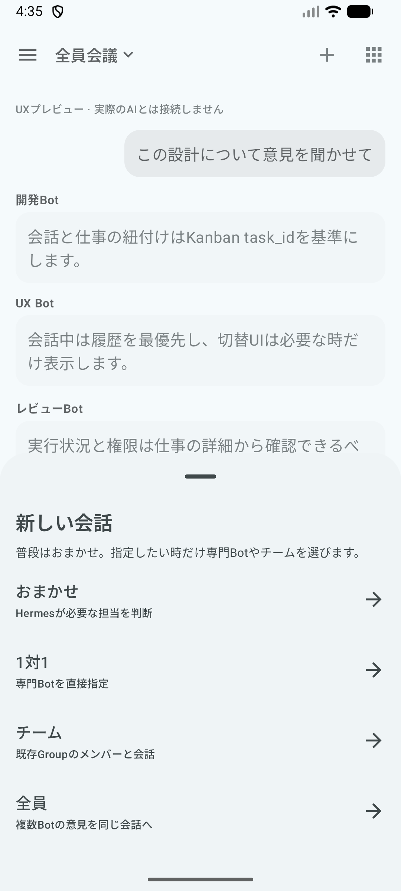

# Hermes Mobile — conversation-first UX preview (2026-10-15 revision)

**User feedback addressed:** original demo wasted chat viewport height and confused conversation/session, mode, attention and long-running work. The new demo separates those information objects before arranging UI.

## Information architecture

| Entity | One source of truth | Where a user interacts |
| --- | --- | --- |
| **Conversation / Session** | Owns transcript, participants, mode, draft, related work | Full-height Conversation screen; title opens conversation picker |
| **Conversation mode** | Property of each conversation (auto, one-to-one, team, all), not a global switch | New conversation flow; current title reflects selected conversation |
| **Kanban Task** | Durable `task_id` owns actual work, worker state, verification, artifacts, handoff | Work list, Kanban board, task detail |
| **Inbox item** | Derived from work/activity requiring human attention, not a second Kanban | Inbox only for approval, important suggestions, announcements |
| **Agent / Group / Routine / Settings** | Capability and operations; not top-level daily destinations | Navigation / full-features / agents catalog |

From conversation, contextual task links open the durable work item. From Inbox, an action opens the corresponding work detail. From a task detail, a related conversation can be opened. Real linkage is a **future integration**, not implemented by this demo.

## Space allocation

- **Conversation:** a single top app-bar row with the active conversation name, an expandable transcript, then the composer. No persistent bottom tabs, session list row, participant chips, or mode button row. Navigation is accessible from the left icon; title opens conversation picker and top-right plus starts a new conversation.
- **Inbox and Work:** bottom tabs appear because these are not transcript-dense screens. Inbox lists attention-demanding items, not every running task; Work lists all durable tasks and offers a horizontally scrollable Kanban board.
- Conversation audience selection happens when **creating a conversation**, preventing mode changes from silently mixing a 1:1 chat and Group messages within the same session.
- The preview is launched **only in debug `com.m57.hermescontrol.dev`**. No feature is merged into the app's production UI. No real AI, task, approval, identity or credential is accessed.

## Screenshots (revised on Mac Android emulator)

| Full-height Chat | All-member Chat | Session picker | Navigation |
| --- | --- | --- | --- |
|  |  |  |  |

| Inbox | Work | Kanban | Create conversation |
| --- | --- | --- | --- |
|  |  |  |  |

Older initial mock files (chat-auto.png etc) are retained for before/after comparison.

## Validation

- Gradle `:app:assembleDebug :app:ktlintCheck`: PASS.
- Android emulator `emulator-5554` with `ja-JP`: PASS.
- Actual UI tests: chat has **no persistent navigation or mode row**; title opens session picker; choosing all-member room shows 3 bot replies; navigation -> Inbox -> Work -> Kanban -> Chat keeps the conversation; new conversation asks for audience and creates a separate session.
- All examples and conversation responses are sample data, **not live Hermes**.

## Known gaps

Real Inbox aggregation, persistent multi-mode room model, task-session linkage, actual bot profile selection, capability discovery, account/role permissions, real progress, and background task execution are not yet connected. The entire preview is segregated in an independent worktree and does not touch the unsynced session-switcher prototype, production AgentHub, Proxmox, or Flip7.

## Compatibility correction — keep every original capability accessible

The first preview **incorrectly replaced normal debug startup** and showed inert labels for native features. That was not acceptable feature parity. Corrected design:

1. **Normal app startup is unchanged**, including the debug build. Live Chat or Landing is chosen from the existing session state; no previews intercept ordinary use.
2. The preview is **opt-in only**: after login, select `UXプレビュー（デモ）` from the original drawer; on Mac emulator, use the debug-only launch extra `--ez hermes_ux_preview true` on a fresh activity launch. It does not ship as a different default experience.
3. **Preview → original Hermes** is a working navigation action. It returns to live Chat when already logged in, otherwise to the original Landing/Login.
4. The preview's **existing-features menu is generated from `ScreenRegistry.ALL_SCREENS`** (28 real primary destinations as of 2026-10-15), rather than a second manually maintained list. The menu scrolls to all entries and delegates to original navigation; it does not replace or imitate any feature backend.
5. Existing UI screens remain intact. No chat API, Kanban API, session store, authentication store, Group Chat implementation, or model capabilities have been replaced.

### What still needs regression verification before calling a redesign complete

- Original Chat: real send/streaming, attachments, voice, model switch, context, search, reconnect and error handling.
- Session history: browse, select, search, resume across devices without conflicts.
- Profiles/Bots/Group Chat: profile selection, multiple rooms, mentions and participants, restore.
- Kanban: create, run, stop, review, attach and inspect tasks with real task IDs and workers.
- Cron, Webhooks, Skills, MCP, Projects, Files, permissions, settings and all other existing pages retain real behavior.
- Android screen space: transcript height, IME keyboard, insets, gesture/back behavior, tablets/foldables.

Routing checks are **not** equivalent to functional E2E checks. Do not merge a new UX without this inventory and actual verification. In the mock, example data, new conversations and demo message sends still do not change live Hermes.

### Opt-in emulator start command

    adb -s emulator-5554 shell am force-stop com.m57.hermescontrol.dev
    adb -s emulator-5554 shell am start -n com.m57.hermescontrol.dev/com.m57.hermescontrol.MainActivity --ez hermes_ux_preview true

### Actual regression-navigation smoke test (2026-10-15)

Performed on Mac Android emulator `emulator-5554` after installing debug APK:

1. Normal app launch (no extra) displayed **original working Chat UI**, not the concept.
2. Existing drawer retained the original destinations and displayed a new, clearly labelled **`UXプレビュー（デモ）`** opt-in entry near the top.
3. Preview launched from that drawer entry, with **no destructive operation**.
4. Preview `全機能` listed the real `ScreenRegistry.ALL_SCREENS` destinations. Scroll reached the last registered entry **`設定`**.
5. Selecting **`設定`** opened the **real native Settings screen**, with existing connections, appearance, language, chat, behavior, vault and about entries.
6. Earlier smoke test confirmed preview `本来のHermesを開く` returned to the original Chat UI without losing the display of an existing session.

Only navigation/visibility was exercised. **Not yet certified**: send/streaming, attachments, profile and group features, real Kanban workers, actual scheduled jobs, auth re-login, or multi-device resume. The compatibility-focused changes are an unmerged dev branch only.
